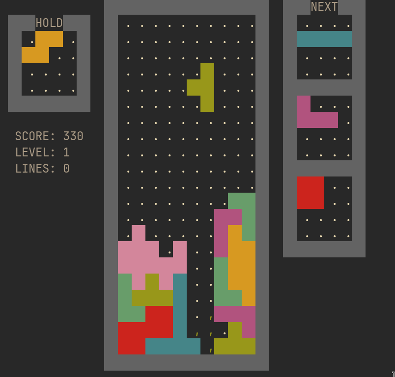

# Titris

CLI Tetris game written in C with modern tetris features, such as:
* Holding Pieces
* Faithul Super Rotation System with Wallkicks
* T-Spins
* Multiple next piece preview windows

As well as other helpful features:
* Piece shadows
* Counter-clockwise rotation
* Well-defined grace period for fallen pieces

You can set flags to customize amount of preview windows, starting level, width and height of the field.
This runs inside of any terminal, and **it can also run inside a TTY** if run with `titris -wz` to enable accurate colors.

Inspired by [Emacs](https://www.gnu.org/software/emacs/) tetris and the one available on the [tetris website](https://play.tetris.com).
      
<p align=center>
    <br>
    <i>Game window with Gruvbox-Dark color scheme</i>
</p>

## Installation

Installation is currently only for Linux.
Dependancies:
* libncurses-dev
* libtinfo (This is provided with libncurses on most distributions)

```console
$ git clone https://github.com/eestsoftware/titris
$ cd titris
$ make 
$ sudo make install
```
Then you can run anywhere with `titris`.

You can specify a make PREFIX to change the installation path (default: /usr/local/bin). For example: `sudo make install PREFIX=~/.local`.

## Usage
Run `titris` in any terminal. Enable `-wz` for better rendering if running inside a TTY.

```sh
Usage: titris [OPTIONS]

Options:
   -h --help              Show this menu.
   -s --solid_color       Disable rendering tetrominos with solid colors, and
                          instead render with text characters.

   -t --term_colors       Disable rendering tetrominos with the terminal color
                          scheme, and use the default one instead (Based on
                          GNU Emacs Tetris)

   -w --white_borders     Render borders with solid white. (Useful for displaying
                          in a TTY)

   -z --z_magenta         Render Z Tetromino as Magenta color (same as J) to
                          render correctly in a TTY.

   -p --popup_score       Disable the text that displays the last action that
                          gave points.

   -l --level_start=AMT   Level at which to start the game. AMT (1-15), default:
                          1.

   -n --next_boxes=AMT    Amount of next preview windows to display. AMT (0-7),
                          default: 3.

   -x --x_width=AMT       Width of the playing field. AMT(7-100), default: 10.

Controls:
   UP    - Rotate Clockwise
   LEFT  - Left
   RIGHT - Right
   DOWN  - Soft Drop
   SPACE - Hard Drop
   C     - Hold
   Z     - Rotate Counter-Clockwise
   P     - Pause
   Q     - Quit
```
